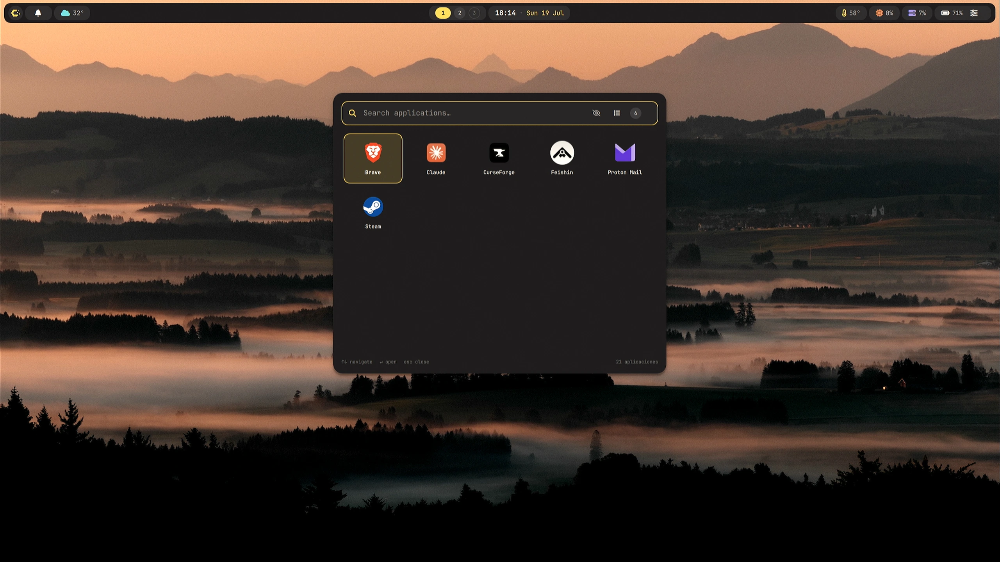
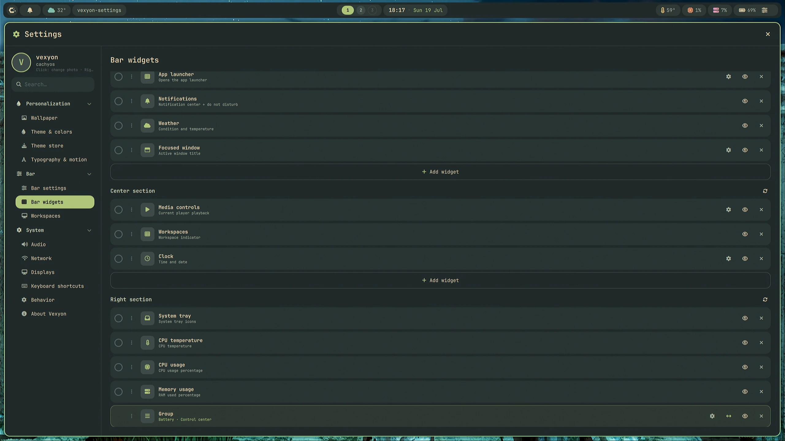
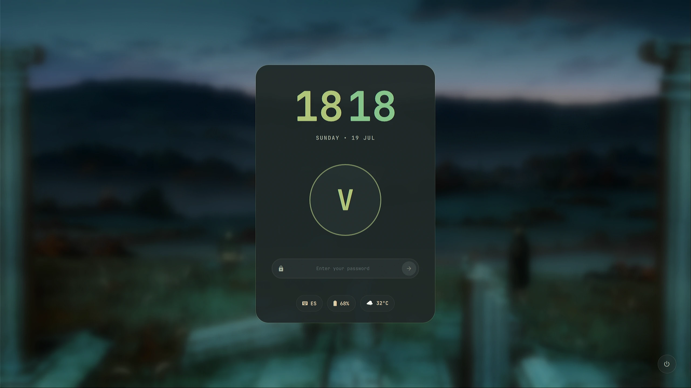

<div align="center">

# Vexyon Shell — NixOS

**A from-scratch Wayland desktop shell for Hyprland — lightweight, fully themeable, and 100% configurable from the UI. No dotfiles required.**

[](CHANGELOG.md)
[](https://nixos.org)
[](https://nixos.wiki/wiki/Flakes)
[](https://hypr.land)
[](https://quickshell.org)
[](https://wayland.freedesktop.org)

<br>



</div>

Vexyon is a complete desktop shell built from scratch in QML on [Quickshell](https://quickshell.org): bar, launcher, panels, settings, lock screen, OSD and even the login greeter are one cohesive, themed system — not a collection of separate tools. Everything is configured from the built-in Settings app; you never have to touch a config file.

> **This is the NixOS track.** It ships a flake and a NixOS module instead of the `install.sh` + `pacman` installer used by the [Arch/CachyOS version](https://github.com/vexyon/vexyon_shell). The shell itself is the same code (the QML is byte-identical in both repos); only the install and system-integration layer differs. [`PROJECT_STATE.md`](PROJECT_STATE.md) records the design and what has been verified.

---

## ✨ Showcase

<div align="center">
<table>
  <tr>
    <td align="center" width="50%">
      <br>
      <sub><b>Dashboard</b> — clock, calendar and weather with hourly forecast</sub>
    </td>
    <td align="center" width="50%">
      <br>
      <sub><b>Settings</b> — add, remove and reorder bar widgets from the UI</sub>
    </td>
  </tr>
  <tr>
    <td align="center" width="50%">
      <br>
      <sub><b>Wallpaper picker</b> — browse and search your wallpapers</sub>
    </td>
    <td align="center" width="50%">
      <br>
      <sub><b>Lock screen</b> — blurred wallpaper, themed clock and status pills</sub>
    </td>
  </tr>
</table>
</div>

---

## Features

- **100% configurable from the UI** — the Settings app covers wallpaper, themes, typography & motion, bar layout, keybinds, audio, network, displays and behavior. Changes apply live: a small bridge regenerates the Hyprland config and reloads it for you. No dotfile editing, ever.
- **Fully themeable** — 26 bundled themes (among them Catppuccin, Tokyo Night, Gruvbox, Rosé Pine, Kanagawa, Solarized, AMOLED, Crimson Voltage and the rest of Omarchy's set: Ethereal, Flexoki Light, Hackerman, Last Horizon, Lumon, Lupine, Matte Black, Miasma, Osaka Jade, Retro 82, Ristretto, Solitude, Vantablack, White) plus a theme store (which also has Nord and Everforest). The active theme drives the whole desktop: bar, panels, OSD, lock screen, greeter and even Hyprland window borders recolor instantly on switch.
- **Modular bar** — add, remove and reorder widgets per section: workspaces, clock, weather, media controls, focused window, system tray, CPU/RAM/temperature, battery, notifications and more.
- **Custom greetd greeter** — the login screen is part of the shell and stays in sync with your theme, language and keyboard layout.
- **Multimedia keys + themed OSD** — volume, brightness, mic mute and media keys work out of the box, with a clean bottom-center OSD that follows your theme. Event-driven (MPRIS and PipeWire handled in-process — no `playerctl`/`wpctl` spawning).
- **Dynamic iGPU pinning for hybrid laptops** — on iGPU + NVIDIA machines the session runs pinned to the iGPU; a udev hotplug handler re-decides on display hotplug, so plugging an external monitor wired to the dGPU works without reboot or re-login. No daemons, no polling.
- **Built-in everything** — app launcher, file manager, clipboard history, screenshot tool with region crop, notification center, quick settings, media / volume / network / battery / system-monitor panels, power menu and a keybind editor.
- **File manager (Super+E)** — copy, cut and paste go through the system clipboard, so they work between file manager windows and with other apps and file managers; your Desktop, Documents, Downloads, Pictures, Music and Videos folders at their real (also translated) paths; sidebar bookmarks you add with right-click → *Add to Sidebar* or by dragging a folder into the sidebar (the same bookmarks GTK file dialogs use); folder icons — a symbol on each user folder and a library of 260 symbols, or your own SVG/PNG, for any folder (right-click → *Customize Folder Icon*). It is also **the file chooser of every app**: a browser's *Upload*, *Save as*, GTK and portal apps and AirDrop open it instead of the GTK dialog.
- **Lock screen with PAM auth** — blurred wallpaper backdrop, themed clock, avatar and status pills (keyboard layout, battery, weather).
- **i18n** — English and Spanish, switchable live from Settings (dates, weather and all UI strings included).
- **Virtual machines** — a built-in VM manager (Super+V) on libvirt/QEMU: create, start, stop, snapshots, shared folders, TPM for Windows 11, OVA import/export, NAT/host-only/internal networks and a graphical display window. **Start with 3D acceleration** renders a Linux guest's graphics on the dedicated GPU (hybrid laptops) or on the main one when it already is the NVIDIA (MUX in dGPU mode, desktops): virtio-gpu with virgl, for that start only — the VM's saved definition is not changed. Windows guests have no 3D driver for it.
- **Screen recording (Super+R)** — record a whole screen (whatever workspace it shows), one window or a region; with system sound, the microphone, or both in one track; at native size or scaled to 1440p/1080p/720p, at the screen's rate or a fixed 60/30 fps.
- **Calculator (Super+Shift+C)** — a quick calculator on the focused screen; nothing runs while it is closed.
- **AirDrop** — send and receive files with nearby iPhones, iPads and Macs, from a bar button: visible for 10 minutes, an hour or until you turn it off, to everyone nearby (or, optionally, only to the Apple IDs you list in Settings); Apple devices see this computer under its **host name** (`networking.hostName`). Received files land in your Downloads folder, go to the clipboard and show up in the notification center. Built on [omdrop-owl](https://github.com/t4t5/omdrop-owl) (AWDL through OWL, for Wi-Fi cards without Apple's chip) and [omdrop](https://github.com/netmojo-systems/omdrop-plugin); which Wi-Fi cards work is in [omdrop-owl's table](https://github.com/t4t5/omdrop-owl#supported-hardware), and Settings → AirDrop tells you about yours and checks every part, administrator access for the radio (pkexec) included. Nothing of it runs until you turn it on.
- **Optional modules, switched from Settings** — virtual machines, Bluetooth, screen recording and AirDrop are installed and on by default; turn off what you don't use in **Settings → Modules** and its background services stop starting, with no rebuild. [More below](#optional-modules).
- **Lightweight by design** — event-driven services, timers that only run when their widget is on screen, minimal external dependencies.

## Requirements

- **NixOS** with flakes enabled
- A system that can run Hyprland on Wayland

Tested against **NixOS 26.05**, with **Hyprland 0.55.4** and **Quickshell 0.3.0** as packaged in `nixpkgs` 26.05. The flake pins `nixpkgs` to `nixos-26.05` itself, so those are the versions you get unless you override the input.

You do **not** need to enable Hyprland, PipeWire, polkit, portals, fonts, libvirt, Bluetooth or anything else yourself — `services.vexyon.enable` plus your username is the whole setup. The module turns on everything every feature needs and pulls in its own runtime dependencies (Quickshell, greetd, ghostty, fish, `awww`, `hyprsunset`, `cliphist`, `grim`, `brightnessctl`, `udisks2`, `wf-recorder`, `hyprpicker`, …). Details in [What the module sets up](#what-the-module-sets-up).

For virtual machines the CPU's hardware virtualization (Intel VT-x or AMD-V/SVM) has to be turned on in the firmware (BIOS/UEFI) settings. That is the one thing no module can do; Settings → Virtualization tells you if it is off.

If flakes are not on yet:

```nix
nix.settings.experimental-features = [ "nix-command" "flakes" ];
```

## Installation

Add the flake as an input and import the module in your system flake. On a default NixOS install that file is **`/etc/nixos/flake.nix`** — the directory that already holds the `configuration.nix` referenced below:

```nix
{
  inputs = {
    nixpkgs.url = "github:NixOS/nixpkgs/nixos-26.05";
    vexyon.url = "github:vexyon/vexyon_shell_nixos";
  };

  outputs = { nixpkgs, vexyon, ... }: {
    # ⚠ REPLACE `myhost` with your own machine's hostname (an identifier — run
    #   `hostname` in a terminal if you are not sure what yours is).
    #   `myhost` appears TWICE: here, and in the `nixos-rebuild switch
    #   --flake .#myhost` command further down. The two MUST match exactly, or
    #   the rebuild will not find this configuration.
    nixosConfigurations.myhost = nixpkgs.lib.nixosSystem {
      system = "x86_64-linux";
      modules = [
        ./configuration.nix
        vexyon.nixosModules.vexyon
        {
          services.vexyon = {
            enable = true;
            # ⚠ REQUIRED — replace `yourname` with your actual Linux username.
            #   `yourname` appears TWICE in this example: here, and in the
            #   `users.users.yourname` line below. Change BOTH, to the same
            #   username.
            user = "yourname";
          };

          # The power menu's polkit rule grants the login1 actions to `wheel`,
          # so the user must be in it or suspend/reboot/shutdown will ask for a
          # password the shell cannot prompt for.
          #
          # ⚠ SECOND occurrence of `yourname` — replace it here too, with the
          #   same username you used above.
          users.users.yourname.extraGroups = [ "wheel" ];
        }
      ];
    };
  };
}
```

Then rebuild and reboot. `--flake .` resolves the flake in the *current* directory, so you have to be standing in the one holding the `flake.nix` you just edited:

```bash
cd /etc/nixos                               # the directory containing your flake.nix
sudo nixos-rebuild switch --flake .#myhost  # ⚠ `myhost` must match nixosConfigurations.myhost above
sudo reboot
```

After the reboot the Vexyon greeter is your login screen — pick the **Vexyon** session and you're in. On first login the shell seeds your personal config into `~/.config/vexyon/shell.json`, `~/.config/hypr/` and `~/.local/share/vexyon/`; from then on those files are yours and the Settings app writes them.

To update later, update the flake input and rebuild (`nix flake update vexyon`, then the same `nixos-rebuild switch`). Your settings and module choices are kept.

### What the module sets up

The optional pieces (libvirt, Bluetooth, NetworkManager, PipeWire, the power services) are set with `lib.mkDefault`, so a value you declare yourself wins:

- **The desktop:** Hyprland, the greetd greeter, portals, polkit, PipeWire (with its PulseAudio server), NetworkManager, UPower, power-profiles-daemon (unless TLP or auto-cpufreq is active), udisks2, PAM for the lock screen, fonts and cursors.
- **Virtual machines:** `virtualisation.libvirtd` with `qemu_kvm`, swtpm (TPM for Windows 11) and virtiofsd (shared folders), `virt-viewer`, your user in the `libvirtd` group, and narrow firewall exceptions for libvirt's bridges (`virbr*`) in whichever firewall you use (iptables or nftables) so VMs get DHCP, DNS and NAT. The rest of your firewall is untouched. With the NVIDIA driver (`services.xserver.videoDrivers = [ "nvidia" ]`), `virtualisation.libvirtd.qemu.verbatimConfig` also lets QEMU open the NVIDIA device nodes (`cgroup_device_acl`), which 3D-accelerated VMs need; it is a `mkDefault`, so a `verbatimConfig` of your own wins.
- **Bluetooth:** `hardware.bluetooth` (bluetoothd only runs when an adapter is present).
- **Screen recording and the rest:** `wf-recorder`, `hyprpicker`, `pactl` (from `pulseaudio`, no daemon), `fuser` (`psmisc`) and `xdg-user-dirs` (the file manager's user folders).
- **AirDrop:** omdrop-owl's own NixOS module, which this flake brings as an input pinned to a commit and built with this flake's `nixpkgs` — you add nothing to your `flake.nix`. `services.omdrop-owl.enable` (a `mkDefault`): its root helper and polkit action (no password from your own session, only while visible), NetworkManager kept off its interfaces, TCP 8771 opened **only on `awdl0`**, `awdl0`'s MAC fixed, and no `wpa_supplicant` restart when it adds or removes an interface. Plus `omdrop` 0.16.4 (pinned), the command and receiver.
- **File chooser and portals:** the shell package as a portal backend (`xdg.portal.extraPortals`: `vexyon.portal` and its D-Bus service) and `xdg.portal.config.hyprland` putting it first for file choosers, `xdg-desktop-portal-gtk` as the fallback (both `mkDefault`, so your own choice wins). `systemd.user.targets.vexyon-session`, which the shell starts at login to bring up `graphical-session.target` — `xdg-desktop-portal` 1.21 and later refuses to start without it, which broke every file chooser and screen share with *"startup job failed"*. See [File manager](#file-manager).
- **Settings → Modules:** a boot unit (`vexyon-modules.service`), a start condition on every service of a module, and a polkit action for the one privileged operation the shell can ask for — see [Optional modules](#optional-modules).

If your configuration already sets one of these itself (for example `virtualisation.libvirtd.enable = true` from Vexyon 2.x's old setup instructions), nothing breaks: your value is used. You can delete those old lines now; the module covers them.

### Module options

That's the whole option surface — everything else is configured at runtime from the Settings app.

| Option | Type | Default | What it does |
|---|---|---|---|
| `services.vexyon.enable` | bool | `false` | Turn the shell on. |
| `services.vexyon.user` | string | *(required)* | The user Vexyon belongs to. The greeter mirrors this user's theme, language and keyboard layout, and owns the mutable greeter state in `/var/lib/vexyon-greeter`. Also added to the `video` and `input` groups, and to `libvirtd` (VMs without a password). |
| `services.vexyon.greeter.enable` | bool | `true` | greetd + the Vexyon greeter as the login screen. Set to `false` to leave login to whatever else you have enabled (the equivalent of the Arch installer's `VEXYON_GREETER=0`). |
| `services.vexyon.gpu.pin` | bool | `true` | Install the udev rules that pin the session to the integrated GPU on hybrid machines and react to display hotplug. Harmless on single-GPU systems — nothing is elected and no symlink is created. |
| `services.vexyon.package` | package | the flake's `vexyon-shell` | Escape hatch to substitute your own build. |

AirDrop's radio has omdrop-owl's own options, all optional: `services.omdrop-owl.enable` (`true` with Vexyon; `false` leaves AirDrop out entirely), `interface` (which Wi-Fi card, e.g. a USB adapter), `channels`, `allowUntested` (try a card nobody has tested yet) and `openFirewall`. See [its README](https://github.com/t4t5/omdrop-owl#readme).

### Building without the module

To just build the package (for hacking on it, or to inspect the closure):

```bash
nix build github:vexyon/vexyon_shell_nixos#vexyon-shell
```

Or from a local checkout:

```bash
nix build .#vexyon-shell     # result/ symlink
nix flake check              # evaluate + build the package
nix develop                  # dev shell with quickshell, hyprland, jq, python3
nix build .#tests.x86_64-linux.modules-gating   # VM test of Settings → Modules (needs KVM)
```

> The package has no single entry-point binary, so there is no `nix run` target — it ships the QML tree plus a set of helpers (`vexyon-start`, `vexyon-bridge`, `vexyon-seed`, `vexyon-gpu-detect`, `vexyon-modules`, …). Use the module to actually run the shell.

### Notes specific to NixOS

- **Your login shell is not changed.** The module enables `programs.fish` because the shell themes it, but it does not set your shell. If you want fish as your login shell: `users.users.yourname.shell = pkgs.fish;`
- **Code lives in the Nix store, state lives in your home.** Unlike the Arch version — where `~/.config/vexyon` holds both the QML and your settings — here only mutable state is in `$HOME`. The QML, helpers and bridge come from the store, so a `nixos-rebuild` updates the shell without touching your config.
- **Greeter state is in `/var/lib/vexyon-greeter`**, not `/etc`. It has to be writable: the bridge rewrites the greeter's theme snapshot on every theme change, and the GPU hotplug handler rewrites the pin there. It is owned by `services.vexyon.user` so none of that needs privilege escalation.
- **AirDrop's name is your host name** (`networking.hostName`). The plugin's files are in the store, so they update with every rebuild; your AirDrop settings (folder, Contacts Only list) are in `~/.config/airdrop` and `~/.config/omdrop`, and this computer's AirDrop identity in `~/.omdrop`.
- **Module choices live in `/var/lib/vexyon/modules`**, root-owned, written only by the `vexyon-modules` helper through polkit. They survive rebuilds, updates and generation switches; a file there means "off from the next boot".
- **The Arch/CachyOS installer (`install.sh`) lives in the [vexyon_shell](https://github.com/vexyon/vexyon_shell) repository** and is not used here.

## File manager

- **Clipboard.** Files you copy or cut are served by `wl-copy` (from `wl-clipboard`), so they stay on the clipboard after the file manager window closes and across a shell restart, until something else is copied. Like any Wayland clipboard, it ends with the session unless a clipboard manager keeps it. Pasting never overwrites: a name that already exists is skipped and the card offers **Keep both**; pasting into the same folder makes a copy named "name (copy)".
- **File chooser for every app.** When an app asks for a file or a folder through the desktop portal — a browser's *Upload*, *Save as*, GTK apps, Flatpaks — a Vexyon file manager window opens in pick mode: Open / Save / Select, the app's file-type filters, a name field when saving (replacing a file asks first), Esc or closing the window cancels. Behind it are `vexyon-portal`, an `xdg-desktop-portal` FileChooser backend started over D-Bus only when an app asks (it exits 30 s later), and `vexyon-pick`, which asks your running shell; the portal configuration puts it first for file choosers with `xdg-desktop-portal-gtk` as the fallback, used automatically when the shell is not running. The session exports `GTK_USE_PORTAL=1` so GTK 3 apps and Firefox go through the portal (Chromium-based browsers already do). AirDrop's *Change* folder button uses `vexyon-pick` directly.
- **User folders.** Created once, in the shell's language, when you close the welcome screen (where the language is picked): `Desktop`, `Documents`, `Downloads`… in English, `Escritorio`, `Documentos`, `Descargas`… in Spanish, plus the folders for wallpapers, screenshots and screen recordings inside them. Never again after that — not on an update, a rebuild or a reinstall — and never if `~/.config/user-dirs.dirs` already exists (your folders, from another desktop or an earlier Vexyon, stay as they are). A `~/.config/user-dirs.conf` with `enabled=False` stops `xdg-user-dirs-update` from recreating or renaming them at login; delete it if you want that tool back.
- **Where things are kept.** Bookmarks: `~/.config/gtk-3.0/bookmarks` (shared with GTK file dialogs, Nautilus and Thunar; lines Vexyon cannot show, like `sftp://`, are kept). Folder icons: `~/.local/share/vexyon/folder-icons.json` and, for your own images, a sanitised copy in `~/.local/share/vexyon/folder-icons/`. Nothing is written inside your folders.

## Optional modules

**Settings → Modules** lists the parts of Vexyon you can turn off. All of them are installed and **on** by default. Switching them needs **no rebuild** and no edit to your configuration: the module ships every unit already, and a boot unit decides at each boot which ones may start.

| Module | When it is off | Applies |
|---|---|---|
| **Virtual machines** | The VM manager and its bar widget are gone, and libvirt's services (`libvirtd`, `libvirtd-config`, `virtlogd`, `virtlockd`, `libvirt-guests` and their sockets) no longer start. | at the next restart |
| **Bluetooth** | The Bluetooth controls are gone and `bluetooth.service` no longer starts, so Bluetooth devices do not connect. | at the next restart |
| **Screen recording** | The recorder, its launcher entry and bar indicator are gone. It has no background service. | immediately |
| **AirDrop** | Its bar button, panel and Settings page are gone, and if this computer was visible the radio and the receiver stop. It has no background service: even on, nothing runs until you turn AirDrop on, and only for as long as you stay visible. | immediately |

- **Turning a module off never removes anything.** Packages stay in your system; VMs, disks, networks, snapshots and Bluetooth pairings are kept. Turning it back on needs no rebuild and no command — just the restart.
- **Nothing is stopped mid-session.** A module with services changes at the next boot, so a running VM or a connected headset is never pulled away. A `nixos-rebuild switch` does not apply pending choices either; only a boot does.
- **System changes need your password once.** The switch asks through the normal polkit dialog; the only thing it can do is record that module choice.
- **Shared services are respected.** If other software you installed uses the same service — virt-manager or cockpit-machines for libvirt, GNOME, Plasma or Blueman for Bluetooth — that service keeps starting even with the module off; only Vexyon's part is hidden. The card names the software.
- **Always on:** the bar, launcher, panels, notifications, lock and login screens, wallpaper, clipboard history, night light, audio, networking and power. Tools like the calculator, screenshots, the color picker and the file manager run only while you use them.
- **Upgrading from 2.x:** if the old Settings → Virtualization switch was off, the Virtual machines module starts off too (turn it on in Settings → Modules). Everything else starts on.

---

<div align="center">

## Support & Socials

Follow the project, or help keep development going — every bit of support is genuinely appreciated 💚

<br>

[](https://www.tiktok.com/@vexyon.dev?is_from_webapp=1&sender_device=pc)
[](https://www.instagram.com/vexyon.dev/)
[](https://ko-fi.com/vexyon)

<sub>If Vexyon makes your desktop nicer, a coffee on Ko-fi is an optional but lovely way to support its development ☕</sub>

</div>
